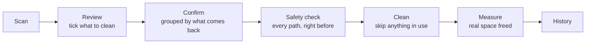

<div align="center">


# CachePop

**Free up space on your Mac, safely.**

A native macOS app that finds the gigabytes developers and everyday apps leave behind (Xcode builds, simulators, package caches, old logs, leftovers of deleted apps) and lets you clean them with a clear view of what comes back and what doesn't.


</div>

---

## Why CachePop

Most cleaners show one big number and a "Clean" button. CachePop shows you **what each thing is, how big it is, and whether it comes back**, and nothing is removed until you confirm.

- 🧹 **Built for developers.** Knows Xcode, simulators, Android emulators, npm, Gradle, CocoaPods, Docker, Homebrew and more.
- 🔍 **Honest about every item.** Each one is labelled *Comes back automatically*, *Downloaded again when needed*, *Moved to the Trash* or *Doesn't come back*.
- 🛡️ **Safe by design.** Paths are re-checked right before deletion, anything in use is skipped, and you can mark folders as *Never Clean*.
- 📏 **Real numbers.** Freed space is measured from the disk afterwards, not guessed from file sizes.

---

## What's inside

| Section | What it does |
|---|---|
| 🗑️ **Clean Up** | Scans for caches and junk, groups them by type, and cleans only what you tick. |
| 📄 **Large Files** | Finds big files and exact duplicates in your personal folders and moves the ones you choose to the Trash. |
| 🖼️ **Photos** | Finds similar shots and blurry, too-dark or overexposed photos in your Photos library and folders. |
| 📈 **System Monitor** | Live CPU, memory, temperatures, fans, disk, network and battery, plus the busiest apps and processes. |
| 🥧 **Disk Usage** | Shows what's taking up space, folder by folder. |
| 🧩 **Applications** | Uninstalls apps together with the settings and caches they leave in your Library. |
| ⏻ **Login Items** | Lists everything that starts on its own and lets you switch it off. |
| ⚙️ **Settings** | Appearance, startup, alerts, the menu bar, what starts ticked, and your Never Clean list. |

### What Clean Up finds

| Group | Examples |
|---|---|
| **Xcode** | Derived data, iOS device support, old device crash logs, Xcode caches, archives older than 3 months |
| **Simulators & emulators** | Parallel-testing clones, SwiftUI preview simulators, broken simulators, unused runtimes, every simulator and Android emulator (erase or delete), unused Android system images |
| **Developer caches** | npm, Yarn, Bun, Gradle, SwiftPM, CocoaPods, pip, Go, Cargo, Maven, Flutter, Android SDK, JetBrains, Playwright, Deno, Codex, Docker, Homebrew, `~/.cache`, and local AI models from Ollama and LM Studio |
| **iPhone & iPad** | Device backups Finder made, and iOS update files |
| **Deleted apps & projects** | Data left by apps you've removed, broken login items, and Claude Code, Codex and editor data for project folders that no longer exist |
| **App caches, logs & Trash** | App caches, Safari's cache, web caches inside apps (Claude, VS Code, Slack…), Mail attachments, old logs and crash reports, installers in Downloads, Time Machine local snapshots, the Trash |
| **Browser history & cookies** | History and cookies in Safari, Chrome, Firefox, Brave, Edge, Arc and Vivaldi. Never ticked for you; bookmarks and passwords are never touched |

### In the menu bar

- **CachePop menu:** free space, your last clean, and a quick scan.
- **Live readings (optional):** chip temperature and fan speed, each as its own menu bar item.
- **Temperature panel:** CPU, SSD, memory and battery temperatures at a glance.
- **Low-space alerts:** one notification when free space drops below the level you pick, at most once a day.

---

## How a clean works



1. **Scan.** All scanners run at the same time and each group appears as soon as it's ready.
2. **Review.** Safe items start ticked; anything permanent, like erasing a simulator or emptying the Trash, starts unticked.
3. **Confirm.** A sheet lists exactly what will happen, grouped by whether it comes back.
4. **Clean.** Every path is checked again by `PathSafety`, and booted simulators, running builds and open apps are skipped.
5. **Measure.** CachePop reads the free space on the disk before and after, and saves the result in **History** (⌘Y).

### Safety rules

- Files are only ever removed from a short list of known cache locations in your home folder.
- Protected places (Documents, Mail, Photos, keychains…) are never touched, and symlinks or `..` can't sneak a path out of a cache folder.
- Folders on your **Never Clean** list are skipped both when scanning and again during the clean.
- Leftovers, installers, backups and large files go to the **Trash**, so you can put them back.

---

## Getting started

### Requirements

- macOS 26.4 or later
- Xcode 26.4 or later to build

### Build and run

```bash
git clone https://github.com/Vasanthadabala/CachePop.git
```

```bash
open CachePop/CachePop.xcodeproj
```

Then pick the **CachePop** scheme and press **⌘R**.

### Permissions

| Permission | Why | Where to turn it on |
|---|---|---|
| **Full Disk Access** (optional) | Lets CachePop see inside the Trash, Safari's cache and history, Mail attachments, device backups and other caches macOS keeps private | System Settings › Privacy & Security › Full Disk Access |
| **Photos** (optional) | Lets the Photos section check your Photos library. Removed photos go to Recently Deleted in Photos for 30 days | Asked the first time you check photos, or System Settings › Privacy & Security › Photos |
| **Fan control helper** (optional, Macs with fans) | Lets you set fan speeds. Fans go back to macOS automatically above 95 °C or when CachePop quits | Settings › General › Fan control, then allow it in System Settings › Login Items |

> [!NOTE]
> CachePop isn't sandboxed, so it can run `simctl` and `brew` and reach developer folders. The fan helper only accepts connections from CachePop signed by the same team. If you build with your own team, update `teamID` in `CachePopShared/FanHelperProtocol.swift`.

---

## Keyboard shortcuts

| Shortcut | Action |
|---|---|
| ⌘1 – ⌘7 | Go to Clean Up, Large Files, Photos, System Monitor, Disk Usage, Applications, Login Items |
| ⌘, | Settings |
| ⌘R | Scan again |
| ⇧⌘⌫ | Clean selected |
| ⌘Y | History |

---

## Project structure

```
CachePop/
├── App/                 App entry, model, settings, commands, low-space alerts
├── Core/
│   ├── Cleanup/         Scanners, cleanup engine, PathSafety, Never Clean, simctl control
│   ├── Services/        File actions, permissions, system info
│   └── UI/              Shared permission prompt
├── Features/
│   ├── CleanUp/         Scan, review and confirm screens
│   ├── LargeFiles/      Big files and duplicates
│   ├── Photos/          Similar, blurry, dark and overexposed photos
│   ├── SystemMonitor/   Live sensors, fan control
│   ├── DiskUsage/       Folder-by-folder space
│   ├── Apps/            Uninstaller and app leftovers
│   ├── LoginItems/      Launch agents, daemons and login apps
│   ├── MenuBar/         Menu bar item and temperature panel
│   ├── History/         Past cleans
│   └── Settings/        Settings tabs
├── Shared/              Theme (colours, type, spacing) and reusable components
└── Debug/               Demo mode (Debug builds only)
CachePopFanHelper/       Privileged helper that sets fan speeds over XPC
CachePopShared/          Code shared by the app and the helper (SMC, XPC protocol)
CachePopTests/           Unit tests (Swift Testing)
CachePopUITests/         UI tests
LaunchDaemons/           launchd plist for the fan helper
```

---

## Development

### Run the tests

```bash
xcodebuild test -project CachePop.xcodeproj -scheme CachePop -destination 'platform=macOS' -parallel-testing-enabled NO
```

### Try it without touching your Mac

Debug builds have a **demo mode** that builds a miniature developer Mac (derived data, simulators, package caches, logs, Trash) in a temporary folder and runs the whole app against it. Cleaning really deletes those fixture files, so you can test the full flow safely.

Add `-CachePopDemo` under **Product › Scheme › Edit Scheme › Run › Arguments**, then run.

### Make a release DMG

`scripts/make-dmg.sh` archives a Release build, signs it with your Developer ID, puts it in a disk image next to an Applications shortcut, then notarizes and staples the disk image. The DMG lands in `build/`.

You need to set these up once:

1. A **Developer ID Application** certificate. Create it in **Xcode › Settings › Accounts › Manage Certificates › + › Developer ID Application**.
2. Notary credentials saved in your keychain. The command asks for an app-specific password, which you can create at account.apple.com under **Sign-In and Security**:

   ```bash
   xcrun notarytool store-credentials CachePop --apple-id <your Apple ID> --team-id 4R2U97FG78
   ```

Then build the release:

```bash
scripts/make-dmg.sh
```

Before you have the certificate, `scripts/make-dmg.sh --dev` makes the same DMG signed with your development certificate. Use it only to check the disk image on your own Mac. `--help` lists the other options.

---

<div align="center">

Made for Macs that are always running out of space.

</div>
