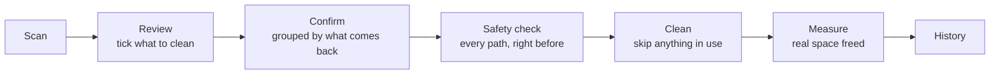

<div align="center">


# CachePop

**Free up space on your Mac, safely.**

A native macOS app that finds the gigabytes developers and everyday apps leave behind (Xcode builds, simulators, package caches, old logs, leftovers of deleted apps) and lets you clean them with a clear view of what comes back and what doesn't.


</div>

---

## Why CachePop

Most cleaners show one big number and a "Clean" button. CachePop shows you **what each thing is, how big it is, and whether it comes back**, and nothing is removed until you confirm.

- 🧹 **Built for developers.** Knows Xcode, simulators, Android emulators, npm, Gradle, CocoaPods, Docker, Homebrew and more.
- 🔍 **Honest about every item.** Each one is labelled *Comes back automatically*, *Downloaded again when needed*, *Moved to the Trash* or *Doesn't come back*.
- 🛡️ **Safe by design.** Paths are re-checked right before deletion, anything in use is skipped, and you can mark folders as *Never Clean*.
- 📏 **Real numbers.** Freed space is measured from the disk afterwards, not guessed from file sizes.

---

## What's inside

| Section | What it does |
|---|---|
| 🗑️ **Clean Up** | Scans for caches and junk, groups them by type, and cleans only what you tick. |
| 📄 **Large Files** | Finds big files and exact duplicates in your personal folders and moves the ones you choose to the Trash. |
| 🖼️ **Photos** | Finds similar shots and blurry, too-dark or overexposed photos in your Photos library and folders. |
| 📈 **System Monitor** | CPU, GPU, Memory, Drive, Battery and Sensors, with live histories and busy processes. |
| 🥧 **Disk Usage** | Shows what's taking up space, folder by folder. |
| 🧩 **Applications** | Uninstalls apps together with the settings and caches they leave in your Library. |
| ⏻ **Login Items** | Lists everything that starts on its own and lets you switch it off. |
| ⚙️ **Settings** | Appearance, startup, alerts, the menu bar, what starts ticked, and your Never Clean list. |

### What Clean Up finds

| Group | Examples |
|---|---|
| **Xcode** | Derived data, extra app builds and UI-test runners, iOS device support, old device crash logs, Xcode caches, archives older than 3 months |
| **Simulators & emulators** | Parallel-testing clones, SwiftUI preview simulators, broken simulators, unused runtimes, every simulator and Android emulator (erase or delete), unused Android system images |
| **Developer caches** | npm, Yarn, Bun, Gradle, SwiftPM, CocoaPods, pip, Go, Cargo, Maven, Flutter, Android SDK, Playwright, Deno, Codex, Docker, Homebrew, `~/.cache`, and local AI models from Ollama and LM Studio. Never ticked for you |
| **iPhone & iPad** | Device backups Finder made, and iOS update files |
| **Deleted apps & projects** | Data left by apps you've removed, broken login items, and Claude Code, Codex and editor data for project folders that no longer exist |
| **App caches, logs & Trash** | App caches, Android Studio and JetBrains indexes, installed sandboxed-app caches, Safari's cache, web caches inside apps (Claude, VS Code, Slack…), Mail attachments, old logs and crash reports, installers in Downloads, Time Machine local snapshots, the Trash |
| **Browser history & cookies** | History and cookies in Safari, Chrome, Firefox, Brave, Edge, Arc and Vivaldi. Never ticked for you; bookmarks and passwords are never touched |

Extra app builds are copies registered with macOS under Xcode build-product folders or a project's `build` folder, including custom locations on other disks. These can cause repeated app results in search. Each starts unticked, shows its path, and offers **Show in Finder** from its context menu. Selected copies move to Trash with Put Back support; installed applications, running copies and release archives are kept. Space is freed when the Trash is emptied.

App cache discovery covers standard Library/Caches folders, known Android Studio and JetBrains index/cache folders, and readable cache directories of installed third-party sandboxed apps. Web caches also include persistent GPU caches and positively identified Chromium browser profiles, including profiles below shared vendor folders. Local History, plugins, settings, chats, credentials, IndexedDB and Service Worker offline storage are kept. Each folder's actual app is checked again before cleaning, so one open app does not hide another app's eligible caches. Unknown cache layouts are left alone. IDE re-indexing can take a while afterwards.

The cache rules follow [Apple's cache-directory guidance](https://developer.apple.com/documentation/foundation/url/cachesdirectory), [JetBrains' system-directory layout](https://www.jetbrains.com/help/idea/directories-used-by-the-ide-to-store-settings-caches-plugins-and-logs.html), and [Electron's separation of caches from persistent app storage](https://www.electronjs.org/docs/latest/api/app/).

### In the menu bar

- **CachePop menu:** free space, live readings, and a quick scan.
- **Live readings (optional):** CPU, GPU, memory, Drive storage used, battery charge, chip temperature, fan speed, Sensors and Network traffic, each as its own menu bar item. Battery uses a compact rounded case with bold charge digits and a charging bolt inside, inspired by the macOS battery icon. Turn each item on in **Settings › Menu Bar**. Sensors and Network start off, as do GPU and Battery.
- **Reading controls:** Settings lists Fan speed, Temperature, CPU, GPU, Memory, Drive, Battery, Sensors and Network in that order. The fan switch stays off, disabled and dimmed when no fans are available. Hold ⌘ and drag an item to arrange it in the macOS menu bar; a reminder appears below the Menu Bar settings.
- **Appearance:** menu bar readings are white; the network upload arrow is red and the download arrow is blue. CPU, GPU, Memory, Drive, Temperature, Sensors and Network reserve fixed 56-point capsules. Battery reserves a fixed 38.9-point capsule; Fan reserves 70 points, and CachePop's icon reserves 35 points. Temperature retains its 13-point text in the compact capsule; larger readings scale only when needed without shifting neighboring items. Battery uses grays matched to the macOS reference, slightly smaller charge digits and a black lightning bolt inside the icon; the bolt appears whenever the power adapter is connected, including while charging is paused; Network uses smaller medium-weight rate values with aligned units, stacking the red upload arrow above the blue download arrow in its compact capsule. Popup titles have no colored dots; charts and data legends retain their identifying colors.
- **Live refresh:** CPU, memory and temperatures update once a second, including in menu-bar-only mode. Enabled CPU and memory menu items refresh their top processes in the background once a second, so the rows are ready before opening a popup. Process queries run separately so they don't delay the live readings; only the small set of top rows is retained while popups are closed.
- **Keep readings running:** when a menu bar item is enabled, ⌘Q switches CachePop to menu-bar-only mode, removing it from the Dock and app switcher. Reopen the main window from the menu bar or Finder. Choose **Quit CachePop** in a menu bar popup or the Dock's Quit command to stop everything.
- **Temperature popup:** CPU → GPU → Memory → Drive → Battery, with neutral icons and right-aligned readings. CPU shows a dash until a reading is available; other components appear when supported. Power, voltage and current readings are available in the Sensors popup and System Monitor's Sensors page.
- **CPU temperature:** uses CPU-specific SMC sensors for the detected chip, with CPU-specific HID sensors as a fallback. Generic power-management die sensors stay separate. Offline/invalid readings are excluded, and fan safety uses the hottest valid CPU sensor. Sensor identities are cross-checked against [Stats' CPU reader](https://github.com/exelban/stats/blob/master/Modules/CPU/readers.swift).
- **Fan panel:** a spinning fan indicator, individual RPM readings, Automatic, Custom and Auto Boost controls. Reduce Motion keeps the indicator still.
- **Individual usage panels:** CPU shows load, frequency, core activity and busy processes; Memory shows pressure, usage breakdown, swap and top processes; Drive shows capacity, health and filled read/write activity on opposite sides of a shared baseline; GPU shows utilisation, temperature and busy clients; Battery shows charge, health, electrical readings and energy impact. GPU and Battery open their corresponding System Monitor pages.
- **Sensors popup:** grouped live temperatures, fan RPM, power, voltage and current readings where supported. Its taller scrolling list expands to fit the screen, keeping the action buttons accessible. Other temperature sensors can be expanded separately. This item is independent of Temperature.
- **Network popup:** balanced upload/download rate cards, a filled two-minute traffic graph with upload above the baseline and download below, saved Today and This month upload/download totals, the tracking start date, primary interface and local IP. Usage counts observed deltas from 64-bit physical Wi-Fi/Ethernet counters without double-counting VPN tunnels. Interface resets, new interfaces and unobserved gaps establish fresh baselines; lifetime counters are never attributed to today. Daily totals use local calendar dates, with month totals resetting at the calendar-month boundary. Short observations across midnight are split proportionally. Tracking starts with the first reading, runs while Network or another network-reading view is enabled, and does not reconstruct earlier usage. Totals survive relaunch; IP addresses and interface identities are not saved. Pending totals are saved at most every 30 seconds and flushed when sampling stops or the app exits. Readings continue with the main window closed. No public-IP lookup or connectivity probe runs. Layouts take [Stats' network popup](https://github.com/exelban/stats/blob/master/Modules/Net/popup.swift) and [sensor grouping](https://github.com/exelban/stats/blob/master/Modules/Sensors/popup.swift) as references.
- **Keyboard access:** while CachePop is active, Control–Command–C/G/M/D/B/S/N opens an enabled CPU/GPU/Memory/Drive/Battery/Sensors/Network panel. Control–Command–T opens Temperature and Control–Command–P opens CachePop. These are ordinary app shortcuts and need no global keyboard permissions.
- **Low-space alerts:** one notification when free space drops below the level you pick, at most once a day.

---

### System Monitor tools

- **Page order:** CPU → GPU → Memory → Drive → Battery → Sensors.
- **CPU:** usage breakdown and history, per-core efficiency/performance bars, 1/5/15-minute load averages, reported cluster frequencies and top processes with PIDs. CPU and memory process lists reserve a separate final Quit column so their values stay aligned. Frequencies use active-state residency and require supported Apple Silicon IOReport channels.
- **GPU:** usage, renderer and tiler histories, memory, temperature, available power and busy GPU clients. Display activity counts compositor swaps across displays; it is not an individual game's frame rate. Neural Engine power appears only when available; utilisation is not guessed from power.
- **Memory:** used/total, app/wired/compressed/free breakdown, pressure and swap histories, with top processes and PIDs.
- **Drive:** volume selection, per-device read/write rates and filled mirrored histories (red writes above the baseline, blue reads below), capacity, filesystem, BSD name, writable/encrypted flags and busy I/O processes. Supported NVMe drives expose read-only SMART temperature, remaining life, lifetime transfers, spare, power cycles/hours and error counters. USB bridges and other unsupported devices show unavailable health data. SMART reads are cached for one minute.
- **Battery:** a rolling 24-hour charge history, plus time remaining, health, cycles, temperature, raw capacities, voltage, current, calculated battery power, charging-paused state and connected adapter limits. Charge readings are saved at minute resolution and survive relaunch. CachePop also recovers available charge observations from macOS's power-event log in the background; these sparse observations are separate from System Settings' battery database. Unrecorded periods remain blank. Other live history charts retain their two-minute view. Busy apps show macOS's relative energy impact, not watts.
- **Sensors & Status:** individual temperature readings grouped by CPU/chip, GPU, memory, Drive, battery and other sensors, with session peaks and Reset Peaks. Availability depends on the Mac.
- **Status checks:** macOS thermal pressure, memory pressure and swap, available Drive space, fan readings, network activity and battery capacity health. These checks do not run hardware self-tests. Read-only SMART details live on the Drive page when supported.
- **Auto Boost:** saved temperature rules boost all fans when thresholds are reached. The strongest matching rule wins; a 3°C release margin prevents rapid switching. Speeds stay within reported fan limits, and heat protection returns control to macOS.
- **Record / Export CSV:** optionally capture up to 1,800 recent numeric readings across CPU, memory, Drive I/O, network, temperatures, fans and battery. Process names and file paths are excluded; recording stays in memory until exported.

### Interface

- **Neutral navigation:** selected sidebar rows use a background highlight without a leading vertical line. Settings uses compact groups, and the downloads threshold dropdown keeps its native blue appearance.
- **Clean Up groups:** each category uses one rounded card containing its header and item rows, separated by subtle dividers. Neutral circular icons, aligned counts and sizes, and a compact results header keep the list easy to scan. Xcode rows omit detail subtext, extra-build reminders, item disclosure arrows, View All controls and entry counts; its section heading retains the expand/collapse arrow. Simulator and Developer caches rows also omit View All and item disclosure arrows; Developer caches rows hide entry counts. Test clones, SwiftUI previews and unavailable simulators each get an individual row and an exact deletion target; device identifiers are omitted from subtext. App caches, logs & Trash rows omit the detail summary and View All button; their disclosure arrow opens the complete searchable entry list. Browser history & cookies also uses its row arrows to open entry lists without View All buttons. Other categories retain selectable previews and **View All**. Browser availability refreshes when apps launch, quit or CachePop becomes active; identifier components distinguish Safari from its system support services, and genuine browser helper processes remain protected. Recovery chips sit beside item titles, followed by the Erase/Delete menu when available. A compact single-line action bar pairs the selected size and count with Clean. Partial choices update the summary and confirmation; only the chosen entries are cleaned. Confirmation rows show each selected category heading and total size, without project lists, file lists or command text; the dialog shrinks to fit short selections. Database companion files and model files stay together. Homebrew and Docker's tool-managed cleanup operations remain atomic. Individual snapshot sizes are shown as unavailable rather than invented.
- **Category colors:** cleanup and disk summaries favor blue, red, orange, green and gray, with purple reserved for additional cleanup categories. Cleanup's bar and legend put the extra purple category last. Solid color shows selected cleanup space; muted color shows the rest.
- **Monitor colors:** efficiency cores use turquoise and performance cores use violet-blue. GPU charts use violet-blue; memory and fans use turquoise; temperature and power charts use orange. Status colors identify normal readings, warnings and low battery charge inside popups.
- **Disk Usage:** the capacity summary distinguishes Applications, Home folder, macOS & other, and Free. Size bars beneath individual folders stay blue. The compact folder-list heading avoids repeating the measurement status shown above.
- **Progress and labels:** Photos, Applications and Login Items share circular loading indicators. Applications shows the percentage of app candidates measured, including candidates it cannot read. The photo source label remains fully visible beside or below **Check Photos**.
- **Window layout:** the sidebar stays visible when resizing or reopening. Intro cards fill the available detail width. Applications use blue for the app and gray for Library files, with a neutral Library folder icon. Login Items has compact section headings and rows, with Login Items Settings at the top-right of its summary card. The redundant Applications footer is removed. Large Files rows omit location/date subtext, with the full path available on hover and through Show in Finder. Duplicate headers show a copies-count chip beside the reclaimable size, without secondary subtitle lines.

## How a clean works



1. **Scan.** All scanners run at the same time and each group appears as soon as it's ready.
2. **Review.** Developer caches, browser history and cookies always start unticked. Other safe items may start ticked; anything permanent, like erasing a simulator or emptying the Trash, starts unticked.
3. **Confirm.** A sheet lists exactly what will happen, grouped by whether it comes back.
4. **Clean.** Every path is checked again by `PathSafety`, and booted simulators, running builds and open apps are skipped.
5. **Measure.** CachePop reads the free space on the disk before and after, and saves the result in **History** (⌘Y). **Done** appears at the top-right of the completion summary.

### Safety rules

- Files are only ever removed from a short list of known cache locations in your home folder.
- Protected places (Documents, Mail, Photos, keychains…) are never touched, and symlinks or `..` can't sneak a path out of a cache folder.
- Folders on your **Never Clean** list are skipped both when scanning and again during the clean.
- Leftovers, installers, backups and large files go to the **Trash**, so you can put them back.

---

## Getting started

### Requirements

- macOS 26.4 or later
- Xcode 26.4 or later to build

### Build and run

```bash
git clone https://github.com/Vasanthadabala/CachePop.git
cd CachePop
open CachePop.xcodeproj
```

Then pick the **CachePop** scheme and press **⌘R**.

### Permissions

| Permission | Why | Where to turn it on |
|---|---|---|
| **Full Disk Access** (optional) | Lets CachePop see inside the Trash, Safari's cache and history, Mail attachments, device backups and other caches macOS keeps private | System Settings › Privacy & Security › Full Disk Access |
| **Photos** (optional) | Lets the Photos section check your Photos library. Removed photos go to Recently Deleted in Photos for 30 days | Asked the first time you check photos, or System Settings › Privacy & Security › Photos |
| **Fan control helper** (optional, Macs with fans) | Lets you set fan speeds. Fans go back to macOS automatically above 95 °C or when CachePop quits | Settings › General › Fan control, then allow it in System Settings › Login Items |

> [!NOTE]
> CachePop isn't sandboxed, so it can run `simctl` and `brew` and reach developer folders. The fan helper only accepts connections from CachePop signed by the same team. If you build with your own team, update `teamID` in `CachePopShared/FanHelperProtocol.swift`.

---

## Keyboard shortcuts

| Shortcut | Action |
|---|---|
| ⌘1 – ⌘7 | Go to Clean Up, Large Files, Photos, System Monitor, Disk Usage, Applications, Login Items |
| ⌘, | Settings |
| ⌘R | Scan again |
| ⇧⌘⌫ | Clean selected |
| ⌘Y | History |
| ⌘Q | Switch to menu-bar-only mode when a menu bar item is enabled; otherwise quit |
| ⌥⌘Q | Quit completely, including menu bar readings (while a menu bar item is enabled) |

---

## Project structure

CachePop uses feature-based MVVM with Clean Architecture boundaries. Feature domain models,
policies and service contracts depend on Foundation; data adapters implement those contracts;
presentation owns SwiftUI views and observable view models. Live adapters are assembled in
`App/Composition/FeatureComposition.swift` and `AppModel`.

```
CachePop/
├── App/                         Entry, navigation, lifecycle and dependency composition
├── Core/
│   ├── Domain/                  Shared values, cleanup models and external-service contracts
│   └── Data/                    Filesystem, command, disk, notification and permission adapters
├── Features/
│   ├── CleanUp/
│   ├── LargeFiles/
│   ├── Photos/
│   ├── SystemMonitor/
│   ├── DiskUsage/
│   ├── Apps/
│   ├── LoginItems/
│   ├── History/
│   ├── Settings/
│   │   └── Each feature uses Domain/, Data/ and Presentation/ as needed
│   └── MenuBar/Presentation/    Native status items and popup presentation
├── Shared/                      Theme, reusable presentation and native UI collaborators
└── Debug/                       Fixture data, demo tour and diagnostics
CachePopFanHelper/               Separate privileged XPC executable
CachePopShared/                  App/helper protocol, portable fan values and SMC adapter
CachePopTests/                   Unit and service-contract tests (Swift Testing)
CachePopUITests/                 Native UI tests
LaunchDaemons/                  Embedded helper launchd configuration
```

Run `python3 scripts/check-architecture.py --typecheck` to check dependency boundaries and
compile the complete domain without any app, UI or data-adapter sources. See
[Architecture](docs/architecture.md) for dependency rules and testing guidance.

---

## Development

### Run the tests

```bash
xcodebuild test -project CachePop.xcodeproj -scheme CachePop -destination 'platform=macOS' -parallel-testing-enabled NO
```

### Try it without touching your Mac

Debug builds have a **demo mode** that builds a miniature developer Mac (derived data, simulators, package caches, logs, Trash) in a temporary folder and runs the whole app against it. Cleaning really deletes those fixture files, so you can test the full flow safely.

Add `-CachePopDemo` under **Product › Scheme › Edit Scheme › Run › Arguments**, then run.

### Make a release DMG

Public builds contain a universal app for Apple silicon and Intel, signed with Developer ID and notarized by Apple. The installer uses a branded drag-to-install window with an Applications shortcut. Generated installers live in `build/`, which is excluded from Git; the current local public installer is `build/CachePop-1.0-public.dmg`.

The latest UI changes are also packaged in `build/CachePop-1.0-unnotarized.dmg`. This local development build has not been notarized. The previous notarized public installer remains unchanged.

Run the commands below from the repository root. Install the Finder layout tool once:

```bash
python3 -m venv build/dmg-tools
build/dmg-tools/bin/python -m pip install -r scripts/dmg-requirements.txt
```

**With a local Developer ID certificate**

`scripts/make-dmg.sh` archives the app, exports it with Developer ID, packages and signs the DMG, submits it to Apple, and staples its notarization ticket. Set up:

1. A **Developer ID Application** certificate. Create it in **Xcode › Settings › Accounts › Manage Certificates › + › Developer ID Application**.
2. Notary credentials saved in your keychain. The command asks for an app-specific password, which you can create at account.apple.com under **Sign-In and Security**:

   ```bash
   xcrun notarytool store-credentials CachePop --apple-id 'you@example.com' --team-id 4R2U97FG78
   ```

Then build the release:

```bash
scripts/make-dmg.sh
```

The signed, notarized DMG lands at `build/CachePop-1.0.dmg`. `scripts/make-dmg.sh --dev` creates `build/CachePop-1.0-dev.dmg` for local testing with a development certificate. `--help` lists the other options.

After changing only the installer artwork or layout, `scripts/make-dmg.sh --dev --repackage` rebuilds the development DMG using the existing exported app. Rebuild the archive after app code changes.

**With Xcode cloud-managed signing**

The public builds produced for this project use Xcode's cloud-managed Developer ID certificate and the signed-in Xcode account. This route submits the app and its embedded fan helper to Apple through Xcode, exports the notarized app with its ticket stapled, and packages that app into a DMG. The ticket belongs to the app; the DMG is its installation container.

<details>
<summary>Cloud signing, notarization and packaging commands</summary>

Use a fresh `build/public-release` output directory and an Xcode account authorized for the project's team. Forks must configure their own signing team and the matching fan-helper team ID.

```bash
mkdir -p build/public-release

python3 - <<'PY'
import plistlib
from pathlib import Path

options = {
    "method": "developer-id",
    "teamID": "4R2U97FG78",
    "signingStyle": "automatic",
    "destination": "upload",
}
Path("build/public-release/ExportOptions.plist").write_bytes(plistlib.dumps(options))
PY

xcodebuild archive -project CachePop.xcodeproj -scheme CachePop \
  -configuration Release -destination 'generic/platform=macOS' \
  -archivePath build/public-release/CachePop.xcarchive \
  -derivedDataPath build/public-release/DerivedData

xcodebuild -exportArchive \
  -archivePath build/public-release/CachePop.xcarchive \
  -exportOptionsPlist build/public-release/ExportOptions.plist \
  -exportPath build/public-release/submission -allowProvisioningUpdates

xcodebuild -exportNotarizedApp \
  -archivePath build/public-release/CachePop.xcarchive \
  -exportPath build/public-release/notarized -allowProvisioningUpdates
```

If Apple is still processing the submission, repeat `-exportNotarizedApp` after processing finishes. Verify the exported app, then build the installer:

```bash
codesign --verify --deep --strict --all-architectures \
  build/public-release/notarized/CachePop.app
xcrun stapler validate -q build/public-release/notarized/CachePop.app
spctl --assess --type execute --verbose=4 \
  build/public-release/notarized/CachePop.app

xcrun swift -module-cache-path build/public-release/SwiftModuleCache \
  scripts/dmg-background.swift build/public-release/installer-background.tiff \
  CachePop/Assets.xcassets/BrandGlyph.imageset/BrandGlyph.png

build/dmg-tools/bin/python -m dmgbuild -s scripts/dmg-settings.py \
  -D app=build/public-release/notarized/CachePop.app \
  -D background=build/public-release/installer-background.tiff \
  'Install CachePop' build/public-release/CachePop-1.0-public.dmg

hdiutil verify -quiet build/public-release/CachePop-1.0-public.dmg
```

Before sharing, mount the finished DMG read-only and repeat the signature, ticket and Gatekeeper checks against the enclosed `CachePop.app`. Preserve the archive and its debug symbols for crash reports. Copy the verified installer to `build/CachePop-1.0-public.dmg` when ready.

</details>

---

<div align="center">

Made for Macs that are always running out of space.

</div>
