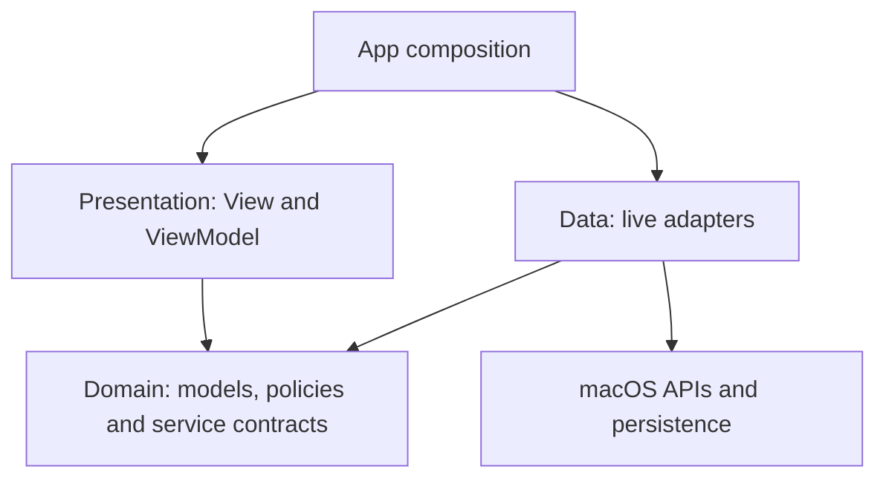

# CachePop architecture

CachePop combines feature-based organization, MVVM presentation, and Clean Architecture dependency boundaries. The app and privileged fan helper remain separate native targets. Feature layers are source folders within the app target; they are not separate framework targets.

## Responsibilities

| Area | Owns | Depends on |
| --- | --- | --- |
| Feature `Domain` | Value models, rules, policies, and interfaces for external operations | Foundation, shared domain values, other domain contracts |
| Feature `Data` | Scanning, image decoding, hardware readers, persistence, and implementations of domain interfaces | Domain and native macOS frameworks |
| Feature `Presentation` | SwiftUI screens, observable view models, transient state, animations, and UI lifecycle | Domain interfaces, shared presentation, native UI collaborators |
| `Core/Domain` | Contracts and values reused across features | Foundation |
| `Core/Data` | Filesystem and command adapters, disk capacity, Trash recovery, permissions, and notifications | Domain and native system APIs |
| `Shared` | Theme, components, icons, and native presentation helpers | Domain and UI frameworks |
| `App` | Composition, navigation, window/application lifecycle, and coordination between features | All application layers |

The Menu Bar feature is presentation for the same monitoring and application state, so it has no duplicate domain or data layer.



The arrows show source dependencies. At runtime a view invokes its view model, which calls an injected domain interface; the live data adapter performs the external operation and returns domain values.

## Dependency rules

- Domain sources import Foundation only. They must compile together without AppKit, SwiftUI, SwiftData, IOKit, the app entry point, or adapter sources. The app/helper `FanSample` value is included in that check.
- View models receive their external operations in designated initializers. They do not construct live engines, open native panels, read folders, register login items, or write UserDefaults themselves.
- `App/Composition/FeatureComposition.swift` provides live convenience initializers. `AppModel` coordinates features, settings, demo dependencies, monitoring clients, history updates, and space refreshes.
- Data sources must not import SwiftUI/Observation, own observable UI state, reference view models, or style components.
- Native UI interactions belong to presentation collaborators. For example, Large Files asks `DesktopInteracting` for a chosen folder rather than constructing an `NSOpenPanel` inside its view model. Window-visibility handling remains a native presentation concern. Process identity, normal termination, self-protection, and native-object caching are handled by an injected process controller.
- Shared code belongs in `Core` only when multiple features use it. Feature-specific scanners and persistence stay with their feature.
- A layer does not need an empty folder, a pass-through use-case wrapper, or a new framework merely to match the diagram.

## Feature contracts

| Feature | External operations exposed to presentation |
| --- | --- |
| Clean Up | `CleanupServicing`, `TrashRestoring` |
| Large Files | `LargeFilesScanning`, `FileClassifying`, `LargeFilePreferencesProviding`, `FileActionPerforming`, `TrashRestoring` |
| Photos | `PhotoScanning`, `PhotoLibraryManaging`, `FileActionPerforming`, `TrashRestoring` |
| Disk Usage | `DiskUsageMeasuring` |
| Applications | `ApplicationManaging`, `AppCataloging` |
| Login Items | `StartupControlling`, `LoginItemsListing` |
| System Monitor | `SystemSampling`, `FanControlling`, `ProcessApplicationControlling`, and a `ProcessorIdentity` value |
| Settings | `SettingsStoring`, `AppLoginControlling` |
| History | `CleanHistoryStoring`, returning plain `CleanHistoryEntry` values |

Application records contain values rather than `NSImage` or running-process handles. Presentation loads bounded display-size icons. Native running-application lookup remains in the Applications adapter.

History's original `CleanRecord` SwiftData entity, field names, store name, and file location are retained. Its adapter maps persisted records to domain entries, keeping SwiftData out of presentation. Existing UserDefaults keys are also retained.

## Verification

Run the boundary check from the repository root:

```sh
python3 scripts/check-architecture.py --typecheck
```

It checks domain imports and outer-layer type references, data-to-presentation references, concrete adapters in view models, feature source placement, and duplicate source basenames. It then invokes the Swift compiler on all domain sources in isolation, treating warnings as errors. The compiler check catches dependencies expressed through functions and extensions that a source-name check can miss. This is source-level enforcement; the app still builds as one module.

Run the complete unit suite:

```sh
xcodebuild test -project CachePop.xcodeproj -scheme CachePop \
  -destination 'platform=macOS' -only-testing:CachePopTests \
  -parallel-testing-enabled NO
```

`ArchitectureContractTests` exercises scans, removal/recovery, Photos access denial, disk measurement, application removal, settings/login registration, process control, and history through injected test services. Existing scanner, safety, resource, navigation, and monitoring tests cover the live implementations against controlled fixtures. Native UI tests verify the composed application.
